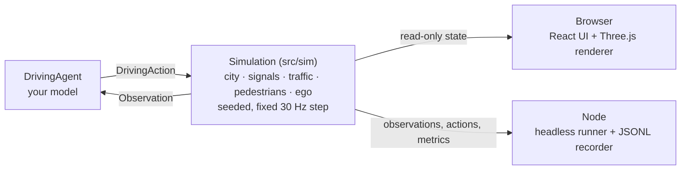

# Rushwick

**A dense-city driving simulator in the browser, built to develop and benchmark self-driving decision models.**

Rushwick generates a busy procedural city with arterial roads, signalized intersections, buses, motorbikes and jaywalking pedestrians, then drops an ego vehicle into it. Your model receives a structured observation every step and returns an acceleration and a steering command. Watch it drive in 3D, or run thousands of deterministic episodes headless in Node and record datasets for imitation learning.

[](https://github.com/aasumitro/rushwick/actions/workflows/ci.yml)
[](https://www.typescriptlang.org/)
[](https://react.dev/)
[](https://threejs.org/)
[](https://vite.dev/)
[](https://vitest.dev/)
[](LICENSE)

---

## Features

- **City.** A procedural grid of two-lane-per-direction arterials and local streets, with sidewalks, crosswalks, parks, street trees and buildings that rise toward downtown. Traffic drives on the left (Indonesia, Japan, UK) or on the right (US, EU, China).
- **Signals.** Fixed-time, multi-stage controllers with permissive or protected turns and pedestrian walk phases.
- **Traffic.** Cars, SUVs, taxis, motorbikes, buses and trucks with IDM car-following, lane changes, junction reservations and don't-block-the-box logic. Background traffic is collision-free by construction, so every collision in the metrics belongs to your model.
- **Pedestrians.** They walk the sidewalk network, cross on the walk signal, and sometimes jaywalk.
- **Ego vehicle.** A kinematic bicycle model with acceleration, braking and steering-rate limits.
- **Model interface.** A structured observation (route, next signal, nearby road users, 2D lidar), a 258-float feature encoder, and a one-method `DrivingAgent` interface.
- **Evaluation.** Episode outcomes, safety and comfort metrics, and a composite driving score.
- **Reproducibility.** The same `(config, seed)` always produces the same episode, in the browser, in tests and in Node.
- **Datasets.** The headless runner records `(features, action)` pairs from the rule-based expert as JSON Lines.

---

## Run It Locally

### Prerequisites

- **Node.js** `22.12+` (developed and tested in CI on Node 26)

### Quick Start

```sh
npm ci
npm run dev
```

Open http://localhost:3000. The ego car starts on **autopilot**, driven by the rule-based baseline.

- **World panel:** seed, driving side, signal mode, traffic and pedestrian density, jaywalking rate. Click **Regenerate city** to apply.
- **Runtime panel:** play, pause and single-step, new episode, decision model, camera, route and lidar overlays, auto-restart, and playback speed from 0.5× to 8×. Changes apply immediately.

### Controls

| Key | Action |
| :--- | :--- |
| `W` `A` `S` `D` or arrow keys | Drive, when the decision model is set to **Manual** |
| `Space` | Pause or resume |
| `N` | Start a new episode |
| `C` | Cycle the camera: chase, orbit, top, driver |

---

## Plug In a Decision Model

A decision model is any object that implements `DrivingAgent`. It receives an `Observation` every control step (30 Hz) and returns a `DrivingAction`.

```ts
import {
  encodeObservation, runEpisode,
  type DrivingAction, type DrivingAgent, type Observation,
} from './src/sim';

class MyModel implements DrivingAgent {
  readonly name = 'my-model';

  act(obs: Observation): DrivingAction {
    const x = encodeObservation(obs); // Float32Array(258), roughly unit-scaled
    // ...run your network on x...
    return { acceleration: 0, steering: 0 };
  }
}

const metrics = runEpisode({ seed: 7 }, new MyModel());
console.log(metrics.outcome, metrics.score);
```

### Action

| Field | Unit | Range |
| :--- | :--- | :--- |
| `acceleration` | m/s², negative brakes | clamped to `[-8, 3]` |
| `steering` | normalized front-wheel angle, positive steers left | `[-1, 1]` |

### Observation

All positions are in the ego frame: x forward, y left.

- **Ego state:** speed, acceleration, steering, yaw rate, vehicle dimensions.
- **Route:** 24 waypoints with speed limits (dense near the car for accurate curvature), lateral and heading error, remaining distance.
- **Next stop line:** distance, light state, and time until the light changes.
- **Road users:** the 10 nearest vehicles and the 10 nearest pedestrians, with relative position, heading, velocity and size.
- **Lidar:** 32 rays in 2D with a 50 m range.

> [!NOTE]
> `route.nextStop.timeLeft` is privileged information that a real AV does not have. Leave it out of your inputs if you want a sim-to-real-honest model.

### Feature Vector

`encodeObservation()` flattens an observation into a fixed-length vector. Missing road users are zero-padded with a presence flag of 0.

```
ego(5) | waypoints(24×3) | route(3) | stop(6) | vehicles(10×9) | pedestrians(10×5) | lidar(32) = 258
```

---

## Headless Runs & Datasets

Evaluate the rule-based agent in Node without a browser. Add `--record` to write `(features, action)` pairs as JSON Lines for imitation learning.

```sh
npm run sim:headless -- --episodes 10 --seed 3 --record runs/expert.jsonl
```

| Option | Default | Description |
| :--- | :--- | :--- |
| `--episodes N` | `5` | Number of episodes to run |
| `--seed N` | `1` | City and traffic seed |
| `--side left\|right` | `left` | Driving side |
| `--vehicles N` | `260` | Background vehicles |
| `--pedestrians N` | `520` | Pedestrians |
| `--record FILE` | none | Output JSONL file |
| `--record-hz N` | `10` | Recording rate in Hz |

Each recorded line has this shape:

```json
{"episode":0,"t":1.2,"features":[0.41,0.02,...],"action":{"acceleration":1.5,"steering":-0.03}}
```

---

## Metrics & Scoring

Every episode ends with exactly one outcome:

| Outcome | The episode ends when the ego vehicle... |
| :--- | :--- |
| `success` | reaches the end of its route (within 8 m) |
| `collision` | touches another vehicle or a pedestrian |
| `offroad` | puts a corner of its body over a curb, or leaves the city |
| `off_route` | stays more than 6 m from its route for over 3 s |
| `timeout` | runs out of time: route length ÷ 1.25 m/s + 30 s, capped at 600 s |
| `stuck` | stays below 0.2 m/s for 120 s without waiting at a signal |

`EpisodeMetrics` also reports route completion, vehicle and pedestrian collisions, red-light violations, off-road events and time, pedestrian near-misses, mean speed, maximum and RMS jerk, maximum lateral acceleration, minimum time-to-collision and stopped time.

`score` is a composite in `[0, 1]`: route completion multiplied by a penalty for every infraction.

| Infraction | Multiplier per event |
| :--- | :--- |
| Collision with a vehicle | 0.5 |
| Collision with a pedestrian | 0.3 |
| Red-light violation | 0.7 |
| Off-road event | 0.75 |
| Pedestrian near-miss | 0.95 |

The score is inspired by the CARLA driving score but is **not** the same formula. Keep it fixed across experiments so that results stay comparable.

---

## Baseline

The built-in rule-based agent steers with path-curvature feed-forward plus Stanley-style feedback, plans speed with IDM and braking envelopes, and decides at amber lights whether it can still stop comfortably.

Results over 18 episodes: seeds 1 to 3, left- and right-hand traffic, 3 episodes each, default density of 260 vehicles and 520 pedestrians.

| Agent | Success | Stuck | Timeout | Collisions | Red lights | Off-road | Near-misses | Mean score |
| :--- | ---: | ---: | ---: | ---: | ---: | ---: | ---: | ---: |
| Rule-based | 14 / 18 | 3 | 1 | 0 | 0 | 0 | 5 | 0.821 |

Every failure comes from driving too cautiously (stuck or out of time), never from driving unsafely. That makes the agent a safe teacher for imitation learning, and a clear target for learned models to beat.

To reproduce the table:

```sh
for side in left right; do
  for seed in 1 2 3; do
    npm run sim:headless -- --episodes 3 --seed "$seed" --side "$side"
  done
done
```

---

## Architecture

The simulation is a headless, deterministic TypeScript core. The browser, the test suite and the Node runner all drive the same `Simulation` class.



```
src/
  sim/                 simulation core: headless, deterministic, no three.js or DOM
    core/              vectors, OBB, rays, polylines, seeded RNG, spatial grid, heap
    world/types/       city data types (road network, intersections, sidewalks, blocks)
    world/generator/   city generator, one stage per file:
                       layout → roads → connectors → conflicts → crosswalks → signals → sidewalks → buildings
    traffic/signals/   signal controller (state is a pure function of time)
    traffic/vehicles/  background traffic: reservations, leaders, obstacles, IDM, lane change, motion, pose
    pedestrians/       navigation, crossing rules, jaywalking, locomotion
    ego/               ego dynamics, routing (Dijkstra + path assembly), observation and feature encoder
    agents/            DrivingAgent interface, rule-based baseline/teacher, manual, idle
    simulation/        CityWorld (background) → Simulation (+ ego episode), evaluation, diagnostics
    metrics/           episode metrics and score
    runner/            runEpisode() for batch evaluation
    index.ts           public API: renderer, UI and scripts import only from here
  render/              read-only Three.js view (instanced meshes, city layers, camera, overlays)
  ui/                  React app: fixed-step loop, input, hooks, panels
scripts/               headless runner and JSONL dataset recorder
```

### Design Principles

- **Simulation is separate from rendering.** The same simulation runs in the browser, in Vitest, and in Node for thousands of episodes.
- **Deterministic by design.** `(config, seed)` always reproduces the same episode, verified with `stateHash()`. Reproducible benchmarks and datasets depend on this.
- **Collision-free background traffic by construction.** A vehicle must hold a connector reservation before it crosses the stop line, and conflicting connectors can never be reserved at the same time. IDM braking is kinematically bounded so trucks and buses never creep past the line.
- **Small, focused modules.** Every source file is under 100 lines and has one responsibility.

---

## Checks & Testing

```sh
npm run typecheck    # tsc --noEmit
npm run build        # typecheck + production bundle in dist/
npm test             # Vitest: geometry, city generation, signals, traffic, determinism, encoder, expert agent
npm run test:watch   # Vitest in watch mode
npm run preview      # serve the production build
```

CI ([`.github/workflows/ci.yml`](.github/workflows/ci.yml)) runs the typecheck, build and tests on every push to `main` and on every pull request.

---

## Contributing

Project rules for contributors and coding agents live in [`AGENTS.md`](AGENTS.md): architecture boundaries, determinism, the data contracts that datasets and trained models depend on, conventions, and a checklist to finish before you open a pull request.

---

## Known Limitations

- The city is a procedural grid, not a real map. OpenStreetMap import is not available yet.
- Motorbikes stay in their lane. Lane filtering (motorbikes weaving between queued cars) is not modeled yet.
- Signals are fixed-time with random offsets. There are no green waves and no adaptive control.
- Background drivers are rule-based and polite. There are no aggressive drivers or adversarial scenarios yet.
- Pedestrians do not avoid each other. If a car blocks them for too long they slip past it (visual overlap only), but they never pass through the ego vehicle.
- A model trained only in Rushwick learns the rules of Rushwick. Measure the sim-to-real gap separately.

---

## License

MIT — see [`LICENSE`](LICENSE).
