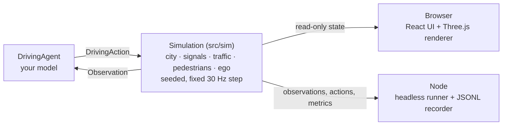

# Rushwick

**A dense-city driving simulator in the browser, built to develop and benchmark self-driving decision models.**

Rushwick generates a busy procedural city with arterial roads, signalized intersections, buses, motorbikes and jaywalking pedestrians, then drops an ego vehicle into it. Your model receives a structured observation every step and returns an acceleration and a steering command. Watch it drive in 3D, or run thousands of deterministic episodes headless in Node and record datasets for imitation learning.

[](https://github.com/aasumitro/rushwick/actions/workflows/ci.yml)
[](https://www.typescriptlang.org/)
[](https://react.dev/)
[](https://threejs.org/)
[](https://vite.dev/)
[](https://vitest.dev/)
[](LICENSE)

---

## Features

- **City.** A procedural grid of two-lane-per-direction arterials and local streets, with sidewalks, crosswalks, parks, street trees and buildings that rise toward downtown. Traffic drives on the left (Indonesia, Japan, UK) or on the right (US, EU, China).
- **Signals.** Fixed-time, multi-stage controllers with permissive or protected turns and pedestrian walk phases.
- **Traffic.** Cars, SUVs, taxis, motorbikes, buses and trucks with IDM car-following, lane changes, junction reservations and don't-block-the-box logic. Background traffic is collision-free by construction, so every collision in the metrics belongs to your model.
- **Pedestrians.** They walk the sidewalk network, cross on the walk signal, and sometimes jaywalk.
- **Ego vehicle.** A kinematic bicycle model with acceleration, braking and steering-rate limits.
- **Model interface.** A structured observation (route, next signal, nearby road users, 2D lidar), a 258-float feature encoder, and a one-method `DrivingAgent` interface.
- **Platform profiles.** Emulate a 1:10 RC car on a Raspberry Pi or a passenger car: noisy, delayed and occluded sensors, delayed and lagging actuators, and a limited control rate. The default `ideal` profile keeps exact sensing.
- **Evaluation.** Episode outcomes, safety and comfort metrics, and a composite driving score.
- **Reproducibility.** The same `(config, seed)` always produces the same episode, in the browser, in tests and in Node.
- **Datasets.** The headless runner records `(features, action)` pairs from the rule-based expert as JSON Lines.

---

## Run It Locally

### Prerequisites

- **Node.js** `22.12+` (developed and tested in CI on Node 26)

### Quick Start

```sh
npm ci
npm run dev
```

Open http://localhost:3000. The ego car starts on **autopilot**, driven by the rule-based baseline.

- **World panel:** platform profile, seed, driving side, signal mode, traffic and pedestrian density, jaywalking rate. Click **Regenerate city** to apply. Picking a platform resets the traffic sliders to that platform's world (an empty track for `rc-pi`).
- **Runtime panel:** play, pause and single-step, new episode, decision model (including **Remote (WebSocket)**, a car program, see [Software-in-the-Loop](#software-in-the-loop)), camera, route, lidar and sensed-object overlays, auto-restart, and playback speed from 0.5× to 8×. Changes apply immediately.
- **HUD:** speed, steering, platform, the delay of the newest command, the next signal, route progress and what the ego currently perceives. On a realistic platform the decision model, the lidar overlay and the **Show sensed objects** outlines all use the sensed observation, and manual driving goes through the platform's actuators too, so you can feel the delay.

### Controls

| Key | Action |
| :--- | :--- |
| `W` `A` `S` `D` or arrow keys | Drive, when the decision model is set to **Manual** |
| `Space` | Pause or resume |
| `N` | Start a new episode |
| `C` | Cycle the camera: chase, orbit, top, driver |

---

## Plug In a Decision Model

A decision model is any object that implements `DrivingAgent`. It receives an `Observation` every control step (30 Hz) and returns a `DrivingAction`.

```ts
import {
  encodeObservation, runEpisode,
  type DrivingAction, type DrivingAgent, type Observation,
} from './src/sim';

class MyModel implements DrivingAgent {
  readonly name = 'my-model';

  act(obs: Observation): DrivingAction {
    const x = encodeObservation(obs); // Float32Array(258), roughly unit-scaled
    // ...run your network on x...
    return { acceleration: 0, steering: 0 };
  }
}

const metrics = runEpisode({ seed: 7 }, new MyModel());
console.log(metrics.outcome, metrics.score);
```

### Action

| Field | Unit | Range |
| :--- | :--- | :--- |
| `acceleration` | m/s², negative brakes | clamped to `[-8, 3]` |
| `steering` | normalized front-wheel angle, positive steers left | `[-1, 1]` |

### Observation

All positions are in the ego frame: x forward, y left.

- **Ego state:** speed, acceleration, steering, yaw rate, vehicle dimensions.
- **Route:** 24 waypoints with speed limits (dense near the car for accurate curvature), lateral and heading error, remaining distance.
- **Next stop line:** distance, light state, and time until the light changes. A realistic platform profile may report the light as `unknown` (not perceived yet) and the time left as `NaN`.
- **Road users:** the 10 nearest vehicles and the 10 nearest pedestrians, with relative position, heading, velocity and size.
- **Lidar:** 32 rays in 2D with a 50 m range.

> [!NOTE]
> `route.nextStop.timeLeft` is privileged information that a real AV does not have. Leave it out of your inputs if you want a sim-to-real-honest model.

### Feature Vector

`encodeObservation()` flattens an observation into a fixed-length vector. Missing road users are zero-padded with a presence flag of 0.

```
ego(5) | waypoints(24×3) | route(3) | stop(6) | vehicles(10×9) | pedestrians(10×5) | lidar(32) = 258
```

---

## Platform Profiles

A platform profile makes the ego vehicle sense and act like a real vehicle: noisy, delayed, rate-limited and occluded sensors, delayed and lagging actuators, and a limited control rate. Pick one with `profile` in the simulation config.

```ts
const sim = new Simulation({ seed: 1, profile: 'rc-pi' });
```

| Profile | Platform | Scale |
| :--- | :--- | ---: |
| `ideal` (default) | Exact sensing and instant actuation, the behavior from before profiles existed | 1 |
| `rc-pi` | 1:10 RC car with a Raspberry Pi 5 | 10 |
| `passenger-car` | Full-size car with a 360° lidar and object detection | 1 |

Profiles are written in real units, as measured on the bench. `resolveProfile()` converts them to sim units: a 1:10 car becomes its full-size twin, with lengths, speeds and accelerations multiplied by 10 and time unchanged. The kinematic bicycle model behaves exactly the same under this transform, so city generation, traffic and signal timing stay untouched.

Key values, in real units:

| | `rc-pi` | `passenger-car` |
| :--- | :--- | :--- |
| Control rate | 20 Hz | 20 Hz |
| Command delay (compute + actuation ± jitter) | 60 + 20 ± 15 ms | 80 + 60 ± 15 ms |
| Longitudinal lag | 0.15 s | 0.35 s |
| Steering-center error (std, per episode) | 0.03 rad | 0.005 rad |
| Localization | ±2 cm, plus a slow 3 cm drift | ±10 cm, plus a slow 20 cm drift |
| Lidar | 10 Hz, 12 m, ±2 cm, 2% dropouts | 10 Hz, 50 m, ±3 cm, 1% dropouts |
| Object detection | 10 Hz, 100 ms late, 100° field of view, 3 m, occlusion | 10 Hz, 100 ms late, 360°, 60 m, occlusion |
| Traffic lights | within 5 m, 5% missed, 2% misread | within 80 m, 2% missed, 1% misread |

What changes for a decision model:

- `sim.observe()` returns what the platform perceives. `sim.observeIdeal()` returns the exact observation, for privileged teachers and debugging.
- Hidden information shows up through values, never through new fields: undetected road users are absent, lidar rays without a return read the maximum range, an unperceived light reads `unknown`, and `timeLeft` is `NaN`. The 258-float feature layout is unchanged.
- Commands are accepted at the control rate, held in between, and reach the wheels after the delay. `sim.controlDue` tells a driver whether the next step accepts a new command.
- Metrics, collision checks and `stateHash()` always use the true state.
- The same `(config, seed)` still produces the same episode: sensor noise is drawn once per physics step, from its own random stream per channel.

> [!NOTE]
> The `rc-pi` values are assumptions until they are measured on the real car. Its world is a **placeholder track** until the room for the physical track is measured: a 2×2 grid at 30 m spacing (a 4.7 m square of floor at 1:10) without traffic. Its four corners are plain turns, so it forms two one-way loops without signals.

---

## Headless Runs & Datasets

Evaluate the rule-based agent in Node without a browser, on any [platform profile](#platform-profiles). Add `--record` to write `(features, action)` pairs as JSON Lines for imitation learning.

```sh
npm run sim:headless -- --episodes 10 --seed 3 --record runs/expert.jsonl
npm run sim:headless -- --episodes 10 --seed 3 --profile rc-pi --teacher ideal --record runs/rc-pi.jsonl
```

| Option | Default | Description |
| :--- | :--- | :--- |
| `--episodes N` | `5` | Number of episodes to run |
| `--seed N` | `1` | City and traffic seed |
| `--side left\|right` | `left` | Driving side |
| `--profile NAME` | `ideal` | Platform profile: `ideal`, `rc-pi` or `passenger-car` |
| `--teacher ideal\|sensed` | `sensed` | What the expert acts on: the exact observation (a privileged teacher) or what the platform senses |
| `--vehicles N` | the profile's (`260` for `ideal`) | Background vehicles |
| `--pedestrians N` | the profile's (`520` for `ideal`) | Pedestrians |
| `--record FILE` | none | Output JSONL file |
| `--record-hz N` | `10` | Recording rate in Hz |

Each recorded line has this shape:

```json
{"episode":0,"t":1.2,"profile":"ideal","featureVersion":1,"features":[0.41,0.02,...],"action":{"acceleration":1.5,"steering":-0.03}}
```

The features always come from the sensed observation, encoded with the simulation's own sensor config, so a model learns from what the platform will really see. To record datasets on a realistic profile, use `--teacher ideal`: the expert then acts on the exact observation and labels the sensed features with clean actions ("learning by cheating"), while its commands still go through the platform's actuators. `featureVersion` changes whenever the feature layout or scaling changes.

---

## Software-in-the-Loop

The program that will drive the real car can drive Rushwick instead, over a WebSocket bridge. The car program is the WebSocket server; Rushwick connects to it, sends a `hello`, then one `frame` per physics step, and applies the `command` the car program sends back. The protocol lives in [`src/bridge/`](src/bridge/).

| Direction | Message | Contents |
| :--- | :--- | :--- |
| Rushwick → car | `hello` | Protocol and feature version, profile, scale, `dt`, control rate, clock mode, latency mode, seed, sensor config |
| Rushwick → car | `frame` | `seq`, `stamp` (sim time in s), `controlTick`, the sensed `observation`, driver-shaped copies of it (`scan`, `imu`, `odom`), and the privileged `teacher` action when requested |
| Rushwick → car | `episode` | `start`, or `end` with the outcome and metrics |
| Car → Rushwick | `command` | The `seq` of the frame it answers, `acceleration` in m/s², normalized `steering` |

```jsonc
{ "type": "frame", "seq": 120, "stamp": 4.0, "controlTick": true,
  "observation": { /* sensed Observation, real units */ },
  "scan": { "angle_min": 0, "angle_increment": 0.19635, "range_min": 0.05, "range_max": 12.0, "ranges": [] },
  "imu": { "angular_velocity": { "z": 0.01 }, "linear_acceleration": { "x": 0.2 } },
  "odom": { "twist": { "linear": { "x": 1.2 } } } }
{ "type": "command", "seq": 120, "acceleration": 0.5, "steering": -0.1 }
```

- Units on the wire are real. Lengths, speeds and accelerations are divided by the profile's scale (10 for `rc-pi`); command accelerations are multiplied back. Angles, yaw rates, times and normalized steering are unchanged.
- Numbers that are not finite, such as an unknown `timeLeft`, travel as `null`.
- On frames without `controlTick` the platform ignores new commands, so the car program resends its last one.
- To encode features like `encodeObservation()`, a car program converts the observation back to sim units and uses the `sensors` config from `hello`. [`autonomy/tests/golden/encoder-v1.json`](autonomy/tests/golden/encoder-v1.json) holds golden vectors to test such an encoder against: sensed observations from every profile (sim units, plus the wire form for `rc-pi`) and their exact features. `npm run sim:golden` regenerates it, byte for byte.
- Field names follow ROS 2 (`sensor_msgs/LaserScan`, `sensor_msgs/Imu`, `nav_msgs/Odometry`), so a later ROS 2 bridge is a 1:1 mapping.

Start a car program that listens on a WebSocket, then let it drive:

```sh
npm run sim:bridge -- --url ws://localhost:8765 --mode lockstep --profile rc-pi --episodes 3 --seed 1 --log runs/bridge.jsonl
```

| Option | Default | Description |
| :--- | :--- | :--- |
| `--url URL` | `ws://localhost:8765` | The car program's WebSocket |
| `--mode lockstep\|realtime` | `lockstep` | Clock mode, see below |
| `--profile NAME` | `ideal` | Platform profile |
| `--episodes N` | `1` | Number of episodes to run |
| `--seed N` | `1` | City and traffic seed |
| `--side left\|right` | `left` | Driving side |
| `--teacher` | off | Add the privileged rule-based teacher's action to every frame |
| `--log FILE` | none | One JSON line per step: `seq`, `stamp`, `rttMs`, `command`, `deadlineMiss`, `watchdog` |
| `--timeout-ms N` | `5000` | Lockstep: abort when a command takes longer |

- **`lockstep`:** Rushwick sends frame `k`, waits for the command with `seq` `k`, applies it and steps. Faster than real time, and deterministic when the car program is deterministic and uses `stamp` as its clock.
- **`realtime`:** Rushwick steps at 30 Hz of wall-clock time and applies the newest command received so far. It runs with `latency: 'measured'`, which leaves the profile's compute delay out of the actuator model because it now happens for real; the actuation delay stays. If no command arrives for 250 ms, the sim brakes fully and counts a watchdog trip, like the watchdog on the car.

The run ends with the episode report, the round-trip latency (p50, p95, p99), deadline misses (a control-tick command that missed its control period), watchdog trips and the final `stateHash()`.

### Rushwick Autonomy: the reference driving stack

[`autonomy/`](autonomy/) holds Rushwick Autonomy (`rushwick-autonomy`), a reference car program in Python. It is the driving stack that will later run on the vehicle's computer: only its hardware backend changes. A safety layer always sits between its policy and the hardware: steering clamp, speed cap, lidar stop and a stale-frame watchdog.

```sh
python3 -m venv .venv && . .venv/bin/activate
pip install -e "autonomy[test]"
rushwick-autonomy --hardware sim --policy simple                   # terminal 1: the driving stack
npm run sim:bridge -- --mode lockstep --profile rc-pi --episodes 3  # terminal 2: Rushwick drives it
pytest autonomy/tests                                               # encoder golden vectors, units, safety, loop
```

| Policy | What it does |
| :--- | :--- |
| `simple` | Pure-pursuit lane keeping at 60% of the posted limit; stops for red, yellow and unknown lights and for road users in its lane |
| `echo` | Returns the privileged teacher's action from each frame (`sim:bridge --teacher`); reproduces an in-process expert run bit for bit |
| `onnx:<path>` | A trained model: encodes the observation like `encodeObservation()`; needs `pip install -e "autonomy[onnx]"` |

The lidar stop is off by default in SIL (`--no-lidar-stop`), because the simulated 2D lidar sees curbs as walls, see [Known Limitations](#known-limitations). `python -m rushwick_autonomy` works as well as the `rushwick-autonomy` command.

The hardware for the 1:10 prototype, sensors included, is specified for two compute boards: [Raspberry Pi 5](autonomy/docs/hardware/pi.md) and [NVIDIA Jetson Orin Nano](autonomy/docs/hardware/jetson.md).

### Watch a car program drive in the browser

With a car program running, open the app, pick **Remote (WebSocket)** as the decision model and enter its URL (default `ws://localhost:8765`, applied on Enter). The browser then works like `--mode realtime`: every simulation step sends a frame, and the newest command received so far drives the car. If no command arrives for 250 ms, the car brakes fully. The HUD shows the connection state, the round trip of the newest command and when the watchdog brakes. To reconnect after the car program restarts, pick the remote model again. The browser keeps modeling the profile's compute delay on top of the real one, so measure latency with `sim:bridge --mode realtime` instead.

---

## Metrics & Scoring

Every episode ends with exactly one outcome:

| Outcome | The episode ends when the ego vehicle... |
| :--- | :--- |
| `success` | reaches the end of its route (within 8 m) |
| `collision` | touches another vehicle or a pedestrian |
| `offroad` | puts a corner of its body over a curb, or leaves the city |
| `off_route` | stays more than 6 m from its route for over 3 s |
| `timeout` | runs out of time: route length ÷ 1.25 m/s + 30 s, capped at 600 s |
| `stuck` | stays below 0.2 m/s for 120 s without waiting at a signal |

`EpisodeMetrics` also reports route completion, vehicle and pedestrian collisions, red-light violations, off-road events and time, pedestrian near-misses, mean speed, maximum and RMS jerk, maximum lateral acceleration, minimum time-to-collision and stopped time.

`score` is a composite in `[0, 1]`: route completion multiplied by a penalty for every infraction.

| Infraction | Multiplier per event |
| :--- | :--- |
| Collision with a vehicle | 0.5 |
| Collision with a pedestrian | 0.3 |
| Red-light violation | 0.7 |
| Off-road event | 0.75 |
| Pedestrian near-miss | 0.95 |

The score is inspired by the CARLA driving score but is **not** the same formula. Keep it fixed across experiments so that results stay comparable.

---

## Baseline

The built-in rule-based agent steers with path-curvature feed-forward plus Stanley-style feedback, plans speed with IDM and braking envelopes, and decides at amber lights whether it can still stop comfortably.

Results over 18 episodes: seeds 1 to 3, left- and right-hand traffic, 3 episodes each, default density of 260 vehicles and 520 pedestrians.

| Agent | Success | Stuck | Timeout | Collisions | Red lights | Off-road | Near-misses | Mean score |
| :--- | ---: | ---: | ---: | ---: | ---: | ---: | ---: | ---: |
| Rule-based | 14 / 18 | 3 | 1 | 0 | 0 | 0 | 5 | 0.821 |

Every failure comes from driving too cautiously (stuck or out of time), never from driving unsafely. That makes the agent a safe teacher for imitation learning, and a clear target for learned models to beat.

To reproduce the table:

```sh
for side in left right; do
  for seed in 1 2 3; do
    npm run sim:headless -- --episodes 3 --seed "$seed" --side "$side"
  done
done
```

### Per platform profile

On a realistic [platform profile](#platform-profiles) the same expert runs in two ways, over the same 18 episodes:

- **Privileged teacher** (`--teacher ideal`): it acts on the exact observation (`sim.observeIdeal()`), but its commands still go through the platform's control rate, delay, lag, deadbands and steering error. Use this to record datasets.
- **Sensed** (`--teacher sensed`, the default): it acts on what the platform perceives (`sim.observe()`), as a learned model will.

| Platform | Observations | Success | Stuck | Timeout | Collisions | Red lights | Off-road | Near-misses | Mean score |
| :--- | :--- | ---: | ---: | ---: | ---: | ---: | ---: | ---: | ---: |
| `passenger-car` | exact (privileged teacher) | 16 / 18 | 2 | 0 | 0 | 0 | 0 | 5 | 0.883 |
| `passenger-car` | sensed | 9 / 18 | 5 | 0 | 1 | 0 | 3 | 0 | 0.671 |
| `rc-pi`, placeholder track | exact (privileged teacher) | 18 / 18 | 0 | 0 | 0 | 0 | 0 | 0 | 0.845 |
| `rc-pi`, placeholder track | sensed | 10 / 18 | 0 | 0 | 0 | 0 | 8 | 0 | 0.629 |

As a privileged teacher the expert stays safe on both platforms. On sensed observations it does not: noise, latency, occlusion and unknown lights cost it collisions and curb strikes. That gap is what a model trained on realistic observations has to close. The `rc-pi` track has no traffic or signals yet, so its episodes are short and only test lane keeping and turning.

To reproduce a row, pick the profile and the teacher (`ideal` for the privileged rows, `sensed` for the others):

```sh
for side in left right; do
  for seed in 1 2 3; do
    npm run sim:headless -- --episodes 3 --seed "$seed" --side "$side" --profile passenger-car --teacher ideal
  done
done
```

---

## Architecture

The simulation is a headless, deterministic TypeScript core. The browser, the test suite and the Node runner all drive the same `Simulation` class.



```
src/
  sim/                 simulation core: headless, deterministic, no three.js or DOM
    core/              vectors, OBB, rays, polylines, seeded RNG, spatial grid, heap
    world/types/       city data types (road network, intersections, sidewalks, blocks)
    world/generator/   city generator, one stage per file:
                       layout → roads → connectors → conflicts → crosswalks → signals → sidewalks → buildings
    traffic/signals/   signal controller (state is a pure function of time)
    traffic/vehicles/  background traffic: reservations, leaders, obstacles, IDM, lane change, motion, pose
    pedestrians/       navigation, crossing rules, jaywalking, locomotion
    ego/               ego dynamics, routing (Dijkstra + path assembly), observation and feature encoder
    platform/          platform profiles (real units), unit scaling, actuator and sensor models
    agents/            DrivingAgent interface, rule-based baseline/teacher, manual, idle
    simulation/        CityWorld (background) → Simulation (+ ego episode), evaluation, diagnostics
    metrics/           episode metrics and score
    runner/            runEpisode() for batch evaluation
    index.ts           public API: renderer, UI and scripts import only from here
  render/              read-only Three.js view (instanced meshes, city layers, camera, overlays)
  bridge/              bridge protocol v1 to a car program: messages, validators, real ↔ sim units
  ui/                  React app: fixed-step loop, input, hooks, panels
scripts/               headless runner, JSONL dataset recorder, bridge runner, encoder golden export
autonomy/              Rushwick Autonomy, the reference driving stack in Python (src/rushwick_autonomy): loop, policies, safety layer, encoder port
```

### Design Principles

- **Simulation is separate from rendering.** The same simulation runs in the browser, in Vitest, and in Node for thousands of episodes.
- **Deterministic by design.** `(config, seed)` always reproduces the same episode, verified with `stateHash()`. Reproducible benchmarks and datasets depend on this.
- **Collision-free background traffic by construction.** A vehicle must hold a connector reservation before it crosses the stop line, and conflicting connectors can never be reserved at the same time. IDM braking is kinematically bounded so trucks and buses never creep past the line.
- **Small, focused modules.** Every source file is under 100 lines and has one responsibility.

---

## Checks & Testing

```sh
npm run typecheck    # tsc --noEmit
npm run build        # typecheck + production bundle in dist/
npm test             # Vitest: geometry, city generation, signals, traffic, determinism, encoder, expert agent
npm run test:watch   # Vitest in watch mode
npm run preview      # serve the production build
pytest autonomy/tests   # the reference driving stack (after pip install -e "autonomy[test]")
npm run sim:echo-check -- --seed 3   # SIL echo check against a running `rushwick-autonomy --policy echo`
```

CI ([`.github/workflows/ci.yml`](.github/workflows/ci.yml)) runs on every push to `main` and on every pull request. One job runs the typecheck, build and tests. A second job tests the driving stack in `autonomy/` with pytest and runs the SIL echo check: the driving stack echoes the privileged teacher over the bridge, and the run must match an in-process run of the same teacher bit for bit (same metrics, same `stateHash()`).

---

## Contributing

Project rules for contributors and coding agents live in [`AGENTS.md`](AGENTS.md): architecture boundaries, determinism, the data contracts that datasets and trained models depend on, conventions, and a checklist to finish before you open a pull request.

---

## Known Limitations

- The city is a procedural grid, not a real map. OpenStreetMap import is not available yet.
- Motorbikes stay in their lane. Lane filtering (motorbikes weaving between queued cars) is not modeled yet.
- Signals are fixed-time with random offsets. There are no green waves and no adaptive control.
- Background drivers are rule-based and polite. There are no aggressive drivers or adversarial scenarios yet.
- Pedestrians do not avoid each other. If a car blocks them for too long they slip past it (visual overlap only), but they never pass through the ego vehicle.
- A model trained only in Rushwick learns the rules of Rushwick. Measure the sim-to-real gap separately.
- Platform perception errors are independent per sample: no tracking ID switches, ghost objects or lights that stay misread. The map is perfect, and there are no camera images, lidar reflections or 3D effects.
- Sensor latency and command delay are quantized to the 33 ms physics step.
- The 2D lidar sees block outlines (curbs) as rectangles with square corners. When the ego cuts a rounded corner, its center can be inside such a rectangle, and every ray then reads 0 (or the profile's minimum range). That is why the reference car program's lidar stop is off in SIL.

---

## License

MIT — see [`LICENSE`](LICENSE).
